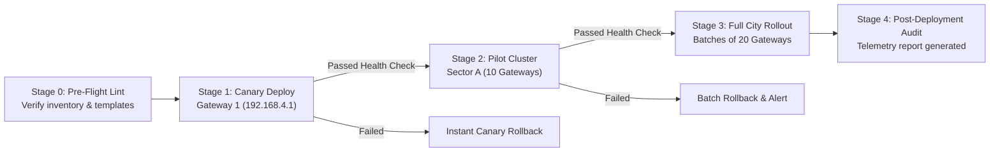

# Production System Design: City-Wide Edge Gateway Orchestration & Automated Data Acquisition Platform

## 1. Executive Summary & Problem Space

### 1.1 Context
In large-scale smart city deployments (smart light poles, environmental monitoring stations, energy microgrids, municipal telemetry), edge gateways bridge physical industrial buses (RS485 Modbus RTU, Ethernet Modbus TCP, dry contacts) to central cloud brokers (MQTT/Kafka).

Currently, scaling from a single pilot gateway (`192.168.4.1`) to **100+ gateways** city-wide introduces operational hurdles:
- **Manual Web Configuration**: Interacting with individual Web GUIs to input device IPs, serial parameters, slave IDs, and register tags is error-prone and unscalable.
- **Heterogeneous Downstream Field Devices**: Each gateway hosts multiple distinct devices (environmental sensors, RGB light controllers, display screens, energy meters).
- **Network Diversity**: Gateways reside across diverse subnets, VPN tunnels, cellular APNs (4G/5G), and private municipal fiber.
- **High Blast Radius**: A corrupted register mapping or failed daemon reload can disrupt critical telemetry feeds or crash field hardware.

### 1.2 System Goals
1. **Declarative State Management**: Define the desired state in code/inventory (GitOps style), ensuring gateways automatically converge to that state.
2. **Bulk Concurrency**: Provision, inspect, and update 100+ gateways in under **2 minutes**.
3. **Zero-Touch Device Provisioning (ZTP)**: Auto-bind downstream devices and tag maps without manual web form entry.
4. **Resilience & Canary Rollouts**: Deploy changes across test batches with pre-flight backups, live validation gating, and automated rollback upon daemon degradation.
5. **Dual Control Plane**: Leverage native high-throughput **HTTP JSON-RPC 2.0** as primary, with **Dropbear SSH** as out-of-band disaster recovery.

---

## 2. Architectural Principles

| Principle | Implementation Strategy |
| :--- | :--- |
| **Idempotency** | Applying a configuration $N$ times results in identical state with zero duplicate device entries or redundant daemon restarts. |
| **Blast Radius Containment** | Failure on Gateway $K$ never blocks or degrades Gateway $K+1$. All operations run in isolated worker tasks with strict timeouts. |
| **State Drift Detection** | The engine computes a mathematical delta between the **Desired State** (Inventory) and **Actual State** (Gateway NVRAM) before writing. |
| **Fail-Safe Rollback** | An immutable snapshot is persisted before write operations. If post-apply telemetry fails validation, previous NVRAM is re-applied automatically. |
| **Zero Plaintext Secrets** | Credentials are decoupled from code into encrypted environment layers or secure vaults. |

---

## 3. High-Level Architecture (C4 Model)

```mermaid
graph TD
    subgraph Central Control Plane
        INV["Inventory Repository<br/>(Git / CSV / CMDB API)"]
        CLI["Orchestration Engine CLI / API<br/>(sync_gateways.py)"]
        CONF["Device Profile Library<br/>(Modbus Register Templates)"]
        VAULT["Secret Manager / .env<br/>(Credentials & Keys)"]
    end

    subgraph Orchestration Core
        SCHED["Asyncio Worker Pool<br/>(Rate Limited: 10-20 workers)"]
        DIFF["State Reconciliation & Diff Engine"]
        SAFE["Rollback & Pre-flight Backup Manager"]
        VAL["Post-Apply Telemetry Verifier"]
    end

    subgraph City-Wide Transport Layer
        VPN["Municipal IPsec / WireGuard / 4G APN"]
    end

    subgraph Edge Gateways (1 to 100+)
        GW1["Gateway 001<br/>192.168.4.1"]
        GW2["Gateway 002<br/>192.168.4.2"]
        GWN["Gateway 100<br/>10.x.x.x"]
    end

    subgraph Downstream Field Devices
        DEV1["Modbus TCP Screen<br/>(Ethernet: 192.168.4.125)"]
        DEV2["Environmental Sensor<br/>(RS485-1: ID 255)"]
        DEV3["RGB Controller<br/>(RS485-2: ID 1)"]
        DEV4["Smart Pole IO<br/>(Digital Outputs)"]
    end

    subgraph Upstream Telemetry Ingestion
        MQTT["Enterprise MQTT Broker Cluster<br/>(EMQX / Mosquitto: 1883)"]
    end

    INV --> CLI
    CONF --> CLI
    VAULT --> CLI
    CLI --> SCHED
    SCHED --> DIFF
    DIFF --> SAFE
    SAFE --> VPN
    VPN -- "JSON-RPC /v1/rpc" --> GW1
    VPN -- "JSON-RPC /v1/rpc" --> GW2
    VPN -- "JSON-RPC /v1/rpc" --> GWN

    GW1 --> DEV1
    GW1 --> DEV2
    GW1 --> DEV3
    GW1 --> DEV4

    GW1 -- "MQTT Telemetry Uplink" --> MQTT
    GW1 -- "Live Verification" --> VAL
    VAL --> CLI
```

---

## 4. Component Deep Dive

### 4.1 Orchestration Core Components

```
src/
├── core/
│   ├── client.py           # Native JSON-RPC 2.0 Session & Request Lifecycle
│   ├── ssh_client.py       # Legacy Dropbear Out-of-Band SSH Manager
│   ├── diff_engine.py      # Computes delta between Desired vs Actual state
│   └── validator.py        # Validates live sensor polling & telemetry health
├── models/
│   ├── gateway.py          # Pydantic schema for Gateway connection & metadata
│   ├── device.py           # Pydantic schema for PLC/downstream device
│   └── datanode.py         # Pydantic schema for Modbus register points
├── storage/
│   ├── inventory_repo.py   # Ingestion of CSV, YAML, and CMDB feeds
│   └── backup_catalog.py   # Versioned JSON snapshot storage with rollback indices
└── engine/
    ├── worker_pool.py      # Asyncio concurrency controller with rate limiting
    └── rollout.py          # Canary & staged batching execution controller
```

#### 1. JSON-RPC Client (`client.py`)
- Manages keep-alive HTTP sessions, bearer token extraction (`sid`), and exponential backoff retry (3 attempts, jittered backoff: 1s, 2s, 4s).
- Implements automated session refresh if tokens expire during long operations.

#### 2. Diff Engine (`diff_engine.py`)
- Queries existing device lists (`smtgw_plc_list_get`) and datanodes (`smtgw_plc_datanode_get`).
- Calculates:
  $$\Delta_{\text{add}} = \text{Desired} \setminus \text{Actual}$$
  $$\Delta_{\text{update}} = \text{Desired} \cap \text{Actual} \quad (\text{if attributes differ})$$
  $$\Delta_{\text{remove}} = \text{Actual} \setminus \text{Desired} \quad (\text{only if prune mode enabled})$$
- By default, $\Delta_{\text{remove}}$ is **masked out** to prevent accidental deletion of existing field assets.

#### 3. Verification & Health Gate (`validator.py`)
- Following a configuration commit (`sys_apply`), the validator monitors `smtgw_plc_status_get` and `smtgw_node_status_get`.
- Confirms:
  1. Daemon state is active (`smtgw3` running).
  2. Target downstream devices report `connect` or valid bus activity.
  3. Reading timestamps are monotonically increasing.

---

## 5. Declarative Data Schemas

### 5.1 Gateway Entity (`inventory/gateways.csv` / `gateways.yaml`)
```yaml
gateway_id: "GW-SEC04-POLE01"
network:
  management_ip: "192.168.4.1"
  management_port: 80
  protocol: "http_jsonrpc"
  ssh_fallback_port: 22
auth:
  username: "Teamtech12!"
  password_env: "GATEWAY_PASSWORD"
location:
  sector: "Sector 4"
  pole_id: "P-04-102"
uplink:
  primary_broker: "192.168.4.124"
  port: 1883
  client_id_prefix: "scmp-pole"
  username: "gw-pole-test"
```

### 5.2 Device & Register Profile Library (`templates/profiles/`)
Standardized hardware templates ensure zero duplicate code when configuring 100 gateways:

#### Profile: `rgb_controller_v1.json`
```json
{
  "profile_id": "rgb_controller_v1",
  "device_defaults": {
    "manufacturer": "MFR_MODBUS",
    "devtyp": "PLC_MDBS_RTU",
    "acq_intv": 500,
    "acqtimeout": 1000,
    "optimization": true
  },
  "registers": [
    {
      "portid": "red_level",
      "datatype": "u16",
      "addrtype": "03(4X)",
      "startaddr": "0",
      "rdwr": "rw",
      "description": "Red Channel (0-255)"
    },
    {
      "portid": "green_level",
      "datatype": "u16",
      "addrtype": "03(4X)",
      "startaddr": "1",
      "rdwr": "rw",
      "description": "Green Channel (0-255)"
    },
    {
      "portid": "blue_level",
      "datatype": "u16",
      "addrtype": "03(4X)",
      "startaddr": "2",
      "rdwr": "rw",
      "description": "Blue Channel (0-255)"
    },
    {
      "portid": "brightness",
      "datatype": "u16",
      "addrtype": "03(4X)",
      "startaddr": "3",
      "rdwr": "rw",
      "description": "Master Brightness (0-100%)"
    },
    {
      "portid": "light_mode",
      "datatype": "u16",
      "addrtype": "03(4X)",
      "startaddr": "4",
      "rdwr": "rw",
      "description": "Scene / Dynamic Mode"
    },
    {
      "portid": "power_state",
      "datatype": "u16",
      "addrtype": "03(4X)",
      "startaddr": "5",
      "rdwr": "rw",
      "description": "Controller Relay State (0/1)"
    }
  ]
}
```

---

## 6. Staged Deployment & Safe Rollout Protocol

To deploy updates safely across 100 gateways without risking a city-wide outage, execution follows a **Canary Pipeline**:



### Staged Rollout Execution Stages
1. **Stage 0: Static Analysis & Pre-flight Ingestion**:
   - Check device IP formats, register ranges, and duplicate station IDs.
   - Ping & reachability sweep across target gateways.
2. **Stage 1: Canary Execution (1 Gateway)**:
   - Apply configuration to Gateway `192.168.4.1`.
   - Run 15-second telemetry sampling soak test.
   - Halt automatically if errors are observed.
3. **Stage 2: Pilot Cluster (10% / 10 Gateways)**:
   - Concurrent deployment across 10 gateways in diverse network sectors.
4. **Stage 3: City-Wide Rollout (Batches of 20)**:
   - Parallel workers process remaining gateways.
   - Concurrency is throttled to 20 parallel TCP connections to prevent switch/VPN saturation.
5. **Stage 4: Audit & Verification Report**:
   - Compiles a timestamped markdown & JSON audit log showing individual success/failure metrics.

---

## 7. Fault Tolerance, Edge Cases & Recovery Matrix

| Scenario / Failure Mode | Detection Mechanism | System Action & Automated Recovery |
| :--- | :--- | :--- |
| **Gateway Offline / Unreachable IP** | Connect timeout (default: 5s) | Mark gateway `UNREACHABLE` in report; isolate failure; continue other 99 gateways without pause. |
| **Authentication Failure** | HTTP 200 with RPC error `-32000` | Log `AUTH_FAILED`; quarantine gateway from batch; notify administrator. |
| **Daemon Reload Crash (`Smtgw no start`)** | `smtgw_plc_status_get` returns error after 10s grace period | **Automated Rollback**: Restore pre-flight backup JSON; re-apply `sys_apply(["smtgw3"])`; alert operator. |
| **RS485 Bus Collision (Duplicate Slave ID)** | Telemetry returns corrupted CRC / null values | Flag warning: `DEVICE_COLLISION_DETECTED`; pinpoint overlapping station IDs in devices inventory. |
| **Power Loss during Commit** | Flash state unreadable on reboot | Gateway OpenWrt fails back to factory overlay; engine detects default IP and triggers disaster recovery re-provisioning. |
| **Web Server Hung (`Libuhttpd` crash)** | Port 80 unreachable but Ping OK | Fall back to **Dropbear SSH (Port 22)**; execute `/etc/init.d/uhttpd restart` over SSH; resume RPC sync. |

---

## 8. Security Architecture & Secret Management

1. **Decoupled Secrets**:
   - Passwords never appear in `gateways.csv` committed to version control.
   - Credentials resolved at runtime via environment variables:
     ```python
     password = os.getenv(f"GW_PASS_{gateway_id}", os.getenv("DEFAULT_GW_PASS"))
     ```
2. **Session Lifecycle & Token Security**:
   - Dynamic session IDs (`sid`) generated per run and discarded on completion via `logout` RPC.
   - No hardcoded permanent API keys stored on edge devices.
3. **Transport Security**:
   - Management sessions routed through private VPN tunnels (IPsec / WireGuard / GRE / 4G APN) or HTTPS.
   - Dropbear SSH restricted to administrative subnets with firewall filters enabled via NVRAM (`sshfilter_enable`).

---

## 9. Performance & Scalability Modeling

### 9.1 Sizing Calculations for 100 Gateways

- **Average Gateway Payload**:
  - Device List Payload: ~1.2 KB
  - Register Maps Payload (4 devices $\times$ 10 registers): ~4.5 KB
  - Total data exchange per gateway: $\approx 25 \text{ KB}$ (including authentication and backup).
- **Network Bandwidth**:
  $$100 \text{ Gateways} \times 25 \text{ KB} = 2.5 \text{ MB total network transit}$$
- **Time to Complete**:
  - Sequential execution: $100 \times 4.2\text{s} \approx 420\text{s}$ (7 minutes).
  - Parallel asynchronous pool (20 concurrent workers):
    $$\text{Time} = \left(\frac{100}{20}\right) \times 4.5\text{s} + \text{jitter} \approx 25\text{--}35 \text{ seconds}$$

### 9.2 Resource Footprint on Host Machine
- **CPU**: Minimal ($< 5\%$ utilization on quad-core laptop).
- **RAM**: $< 120 \text{ MB}$ (lightweight async I/O coroutines).
- **Dependencies**: Pure Python (`requests`, `pydantic`, `jinja2`). No heavy external services required.

---

## 10. Operational Runbook & Production CLI

The platform CLI provides clear operational commands for operations teams:

```bash
# 1. Full Read-Only Inspection across all 100 gateways (Pre-check)
python sync_gateways.py --mode inspect --inventory inventory/gateways.csv

# 2. Automated Full Snapshot Backup for Disaster Recovery
python sync_gateways.py --mode backup --inventory inventory/gateways.csv

# 3. Canary Dry-Run Test against pilot gateway (192.168.4.1)
python sync_gateways.py --mode sync --canary 192.168.4.1 --dry-run

# 4. Production Staged Rollout (10 Gateways, then full batch)
python sync_gateways.py --mode sync --inventory inventory/gateways.csv --batch-size 10 --auto-rollback

# 5. Rollback a specific gateway to a prior timestamp snapshot
python sync_gateways.py --mode rollback --gateway 192.168.4.1 --backup backups/PRE_ADD_RGB_192.168.4.1_20261010_151051.json
```

---

## 11. Conclusion & Next Milestones

With the system design validated by live testing on `192.168.4.1`:
1. The **JSON-RPC 2.0 communication engine** is proven.
2. The **Four-Faith `smtgw3` lifecycle** (device registration, register injection, NVRAM persistence, and verification) is verified.
3. The platform is ready to scale from 1 to 100 gateways city-wide.
